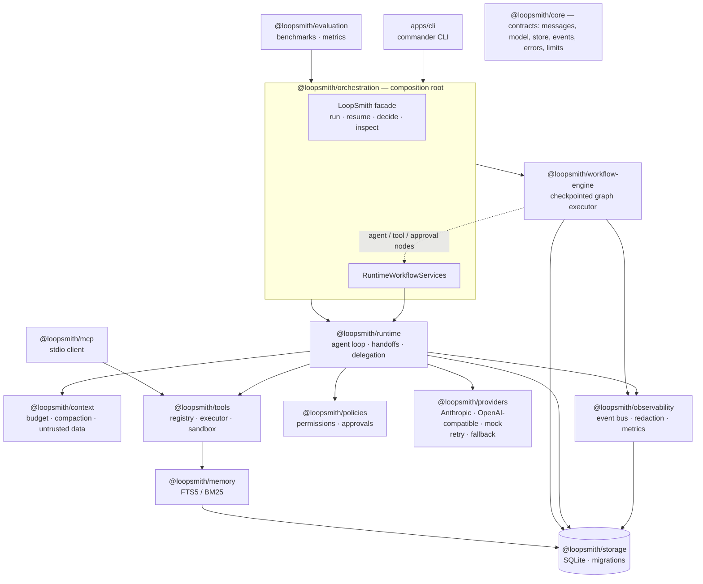
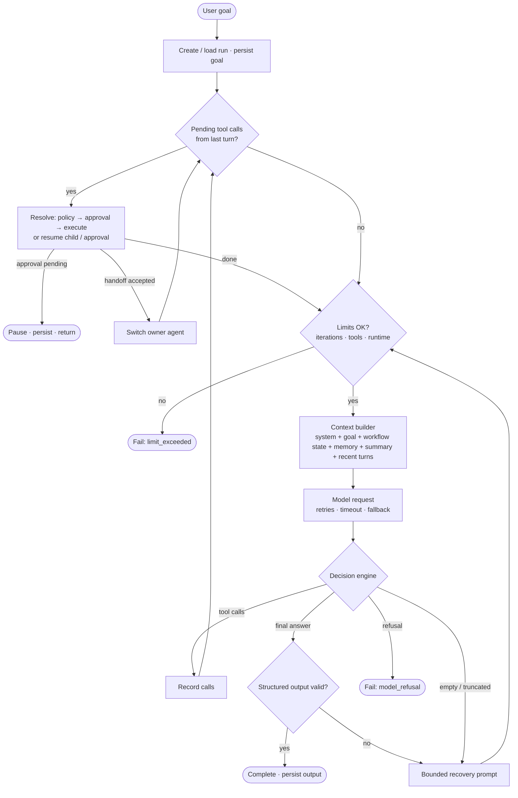
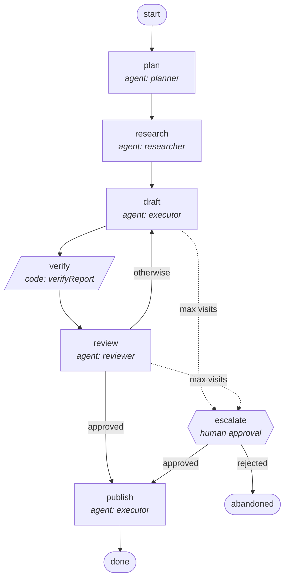
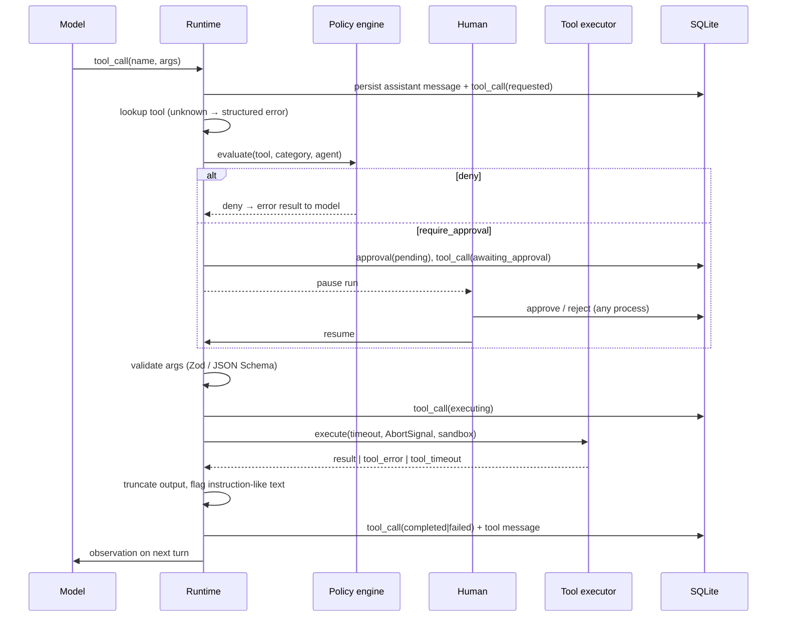

# LoopSmith

**An extensible, provider-agnostic agent runtime for autonomous workflows, tool orchestration, persistent execution, and human-controlled AI systems.**


LoopSmith is the infrastructure *around* a language model that turns it into a bounded, stateful, tool-using system: the agent loop, tool execution, permissions, human approvals, workflows, multi-agent handoffs, persistence, context management, tracing and evaluation. It is written from scratch in TypeScript — **no LangChain, LangGraph or agent SDK runs the loop**. The official Anthropic and OpenAI SDKs are used only as HTTP clients.

```bash
pnpm install && pnpm build && node apps/cli/dist/index.js demo
```

The demo needs **no API key**: a deterministic model policy drives a five-agent workflow that inspects a real sample workspace with real tools, pauses for your approval before writing, and persists every step to SQLite.

---

## Contents

1. [Why an agent harness?](#1-why-an-agent-harness) · 2. [Key features](#2-key-features) · 3. [Architecture](#3-architecture) · 4. [The agent loop](#4-the-agent-loop) · 5. [Workflow orchestration](#5-workflow-orchestration) · 6. [Tool execution lifecycle](#6-tool-execution-lifecycle) · 7. [Permissions and approvals](#7-permissions-and-approvals) · 8. [Memory and context](#8-memory-and-context) · 9. [Providers](#9-providers) · 10. [MCP status](#10-mcp-status) · 11. [Observability](#11-observability) · 12. [Evaluation](#12-evaluation) · 13. [Installation](#13-installation) · 14. [Quick start](#14-quick-start) · 15. [Live providers](#15-live-provider-setup) · 16. [Configuration](#16-configuration-reference) · 17. [CLI](#17-cli-commands) · 18. [Example workflows](#18-example-workflows) · 19. [Security](#19-security-considerations) · 20. [Limitations](#20-limitations) · 21. [Roadmap](#21-roadmap) · 22. [Project layout](#22-project-layout)

---

## 1. Why an agent harness?

A model call is stateless and unaccountable. Production agents need everything in between: deciding what the model's output *means*, validating untrusted tool arguments, enforcing permissions in code (not in the prompt), pausing for a human and resuming hours later in another process, recovering from provider outages without repeating side effects, keeping context inside a budget, and leaving a trace you can audit and evaluate. That machinery — the harness — determines whether an agent is safe and debuggable far more than the choice of model. LoopSmith is a compact, inspectable implementation of it.

## 2. Key features

| Area | What is implemented |
|---|---|
| **Agent loop** | Bounded loop (iterations, tool calls, runtime, retries, recovery attempts, context budget, per-tool timeout), decision engine for final answer / tool calls / handoff / delegation / approval / invalid output, cancellation via `AbortSignal` |
| **Tools** | Typed registry (Zod → JSON Schema), validation before policy and approval, timeouts, output limits, structured errors, idempotency flags; `workspace.list/read/search/write`, `calculator.evaluate`, `memory.search/store` |
| **Security** | Permission engine (allow / require_approval / deny by category and tool, agent overrides can only tighten), workspace sandbox (traversal, absolute paths, symlink escapes, secret files), secret redaction, untrusted-content flagging |
| **Approvals** | Persisted approvals, run pause, CLI approve/reject, resume in a new process, decisions recorded and audited |
| **Workflows** | Declarative, JSON-serialisable graphs: agent / tool / approval / code / end nodes, conditional transitions, loop-backs bounded by `maxVisits` and `maxSteps`, retries, error routes, checkpoint after every node |
| **Multi-agent** | `agent.handoff` (ownership transfer) and `agent.delegate` (bounded sub-run) with allow-listed destinations, depth and count limits, handoff history |
| **Persistence** | SQLite (WAL) with forward-only migrations: sessions, runs, messages, tool calls, approvals, checkpoints, events, memory, summaries, handoffs |
| **Recovery** | Resume paused or interrupted runs; completed tool calls never repeat; interrupted idempotent tools re-run; interrupted side effects are *not* retried and are reported to the model |
| **Context** | Context builder, token *estimates*, old tool-output elision, compaction into a persistent summary (extractive or model-written), turn-safe (never splits tool calls from results) |
| **Memory** | Long-term memory in SQLite FTS5 with BM25 ranking, session/global scopes, deduplication |
| **Providers** | Anthropic (official SDK), OpenAI-compatible (official SDK, custom base URL), deterministic scripted mock; retries with backoff + jitter + `retry-after`, provider fallback chains |
| **MCP** | stdio client: discovery, JSON-Schema validation (ajv), invocation through the same policy engine — tested against a real MCP server |
| **Observability** | 42 structured event types, terminal traces, JSONL export, run inspection, metrics, token usage, cost estimates only for known prices |
| **Evaluation** | 25-task benchmark suite with per-task checks and a global "no unapproved side effects" invariant; mock and live modes, clearly separated |

## 3. Architecture



Every package depends on `@loopsmith/core` contracts, not on each other's internals. The workflow engine knows nothing about LLMs; the runtime knows nothing about vendors. See [docs/architecture.md](docs/architecture.md).

## 4. The agent loop



There is no unbounded `while (true)`: each pass is bounded by `maxIterations`, `maxToolCalls`, `maxRuntimeMs`, `maxRecoveryAttempts`, `maxHandoffs`, and a hard safety cap on loop turns. Every transition is written to SQLite *before* it is acted on, which is what makes pause/resume and crash recovery possible. Details: [docs/agent-loop.md](docs/agent-loop.md).

## 5. Workflow orchestration

The flagship workflow, rendered by `loopsmith workflows show workspace-analyst --mermaid`:



Workflows are plain data (validated with Zod, with graph checks for dangling and unreachable nodes). Conditions are declarative (`{ path: 'state.review.verdict', equals: 'approved' }`), so definitions can be stored, diffed and rendered. The review loop is bounded by `maxVisits`; when exhausted, a human approval gate decides. See [docs/workflows.md](docs/workflows.md).

## 6. Tool execution lifecycle



## 7. Permissions and approvals

| Operation | Category | Default |
|---|---|---|
| Read workspace files | `read` | Allow |
| Search workspace | `search` | Allow |
| Calculator | `compute` | Allow |
| Search / store memory | `memory.read` / `memory.write` | Allow |
| Agent handoff / delegation | `orchestration` | Allow (destinations allow-listed per agent) |
| Write files | `write` | **Require approval** |
| MCP tools | `external` | **Require approval** |
| Execute commands | `execute` | **Deny** |
| Network access | `network` | **Deny** |
| Destructive operations | `destructive` | **Deny** |

Precedence: a tool outside the agent's allow-list is denied; then the most specific operator tool rule, else the category default; agent permissions can only make it **stricter**. Denied tools are not even shown to the model. Approvals are rows in SQLite: the run pauses, any process can decide (`loopsmith approvals approve <id>`), and `runs resume` continues the *same* run. The model is never trusted to enforce policy.

## 8. Memory and context

* **Short-term:** the persisted transcript of each run (goal pinned as message 0), tool observations, handoff notes, and shared workflow context (`contextKeys`) injected into the system prompt.
* **Long-term:** `memory.store` / `memory.search` over SQLite FTS5 with BM25 ranking; natural-language queries are sanitised into quoted FTS terms; agents with `memory.recall` get relevant memories injected as *untrusted* data. No vector database — keyword retrieval is deterministic and sufficient for explicitly saved facts; the `MemoryService` interface allows a vector backend later.
* **Context engineering:** token budget **estimates** (~4 chars/token — explicitly not a tokenizer), elision of large old tool outputs, then compaction of the oldest turns into a persistent summary (`extractive` by default, `model` optional, `truncate` available). System instructions, goal, workflow state and recent turns are always preserved; tool calls are never separated from their results; every compaction is persisted and emitted as `context.compacted`.

Details: [docs/memory-and-context.md](docs/memory-and-context.md).

## 9. Providers

| Provider | Implementation | Notes |
|---|---|---|
| `anthropic` | `@anthropic-ai/sdk` Messages API | Default model `claude-opus-5-5`; tool names encoded for the wire (`workspace.read` → `workspace__read`); raw assistant content (incl. thinking blocks) replayed verbatim; consecutive tool results merged into one user turn; sampling params not sent |
| `openai` | `openai` SDK, Chat Completions | Any compatible endpoint via `OPENAI_BASE_URL` (vLLM, Ollama, LiteLLM, OpenRouter, gateways); model must be set explicitly; malformed argument JSON is captured, never executed |
| `mock` | `ScriptedProvider` | Deterministic, offline; scripts keyed by agent turn derived from the *persisted* transcript, so scripted runs are resume-safe across processes; never reports invented token usage |
| `fallback` | `FallbackProvider` | `LOOPSMITH_FALLBACK=anthropic,openai`; falls through only on provider-level failures |

All providers are wrapped in `ResilientProvider`: per-attempt timeout, bounded retries with exponential backoff and full jitter, `retry-after` support, retries only for transient / rate-limit / timeout errors. The provider adapters are tested **over HTTP** against local fake servers with the real SDKs (no keys required). See [docs/providers.md](docs/providers.md).

## 10. MCP status

**Implemented (minimal, tested):** stdio transport via the official `@modelcontextprotocol/sdk` client, paginated tool discovery, JSON-Schema → validator conversion (ajv), namespaced registration (`mcp.<server>.<tool>`), invocation with timeout and abort, `isError` handling, and **the same policy/approval path as native tools** (category `external` → approval by default). Tested against the bundled example server in `examples/mcp-server`.
**Not implemented yet:** Streamable HTTP/SSE transports, resources, prompts, sampling, OAuth. See [docs/mcp.md](docs/mcp.md).

## 11. Observability

Every state change emits one structured, redacted event (42 types) with session/run/root-run/agent/node ids, timestamps and durations. Events are persisted, rendered live in the terminal, and exportable as JSONL. Real output of `loopsmith demo --defer`:

```text
◇ node research (agent: researcher, visit 1)
  ▶ run run_30a3d0b31b0747f4bbcd started (agent: researcher)
  ● [researcher] agent selected (mock/scripted-v1)
  ◆ [researcher] model → 9 tool calls 0ms
  ⚙ [researcher] workspace.read {"path":"README.md"} ok 3ms
  ⚙ [researcher] workspace.read {"path":"src/server.js"} ok 1ms
  ⚠ [researcher] untrusted content flagged in workspace.read: ignore-previous-instructions
  ⚙ [researcher] workspace.read {"path":"docs/NOTES.md"} ok 2ms
  ⚙ [researcher] workspace.read permission_denied: Reading ".env" is blocked by the workspace policy
  ⚙ [researcher] workspace.search {"query":"TODO|FIXME|HACK","path":".","regex":true,"caseSen… ok 16ms
  ⚙ [researcher] calculator.evaluate {"expression":"round(5 / 104 * 1000, 2)"} ok 1ms
  ☰ [researcher] memory stored: Workspace analysis of inventory-service: 10 findings (3 high: hardcod…
...
◇ node review (agent: reviewer, visit 1)
  ⚙ [reviewer] workspace.read {"path":"src/server.js","startLine":4,"endLine":4} ok 1ms
  ↓ review → draft (default)
◇ node draft (agent: executor, visit 2)
...
◇ node publish (agent: executor, visit 1)
  ⏸ approval required apr_982d5e0bfc094642a563: workspace.write reports/workspace-analysis.md (5154 chars) — requested by execu…
⏸ workflow paused at publish: awaiting_approval

⏸  Approval required apr_982d5e0bfc094642a563
   what:   workspace.write reports/workspace-analysis.md (5154 chars) — requested by executor
   policy: workspace.write (write) requires human approval (categories.write)
   run:    run_e08cefa1636146d38dcb (node publish)
The run is paused and fully persisted. To continue:
  loopsmith approvals approve apr_982d5e0bfc094642a563 --resume
```

Then, in a **separate process**, `loopsmith approvals approve apr_982d5e0bfc094642a563 --resume`:

```text
✓ apr_982d5e0bfc094642a563 approved by cli:user: workspace.write reports/workspace-analysis.md (5154 chars) — requested by executor
↻ workflow resumed at node publish
  ↻ run run_e08cefa1636146d38dcb resumed awaiting_approval
  ⚙ [executor] workspace.write {"path":"reports/workspace-analysis.md","content":"# Worksp… ok 4ms
  ◆ [executor] model → final answer 1ms
  ↓ publish → done (next)
✔ workflow completed
Run wf_b318b8f80bba40d081a4 · workflow workspace-analyst · completed
14 model calls · 16 tool calls (1 errors, 0 denied) · 1 approvals (1 approved, 0 rejected) · 0 handoffs · 0 delegations · 0 retries · 0 recoveries · 0 compactions
tokens: not reported by the provider (the mock provider never invents usage)
Output
  Report saved to reports/workspace-analysis.md: 10 findings (3 high, 5 medium, 2 low). Review verdict: approved after 2 draft(s).
```

`loopsmith runs inspect <id>` shows the run tree, every tool call with its policy effect, approvals, agent transitions, workflow path and timeline:

```text
Run tree
  wf_b318b8f80bba40d081a4  workflow:workspace-analyst  completed
  ├─ run_f2c2c779fb57410790d5  agent:planner  completed  2 iter · 2 tools  [node plan]
  ├─ run_30a3d0b31b0747f4bbcd  agent:researcher  completed  4 iter · 11 tools  [node research]
  ├─ run_4f04623b066c432582fb  agent:executor  completed  1 iter · 0 tools  [node draft]
  ├─ run_040f135b242f4a97887e  agent:reviewer  completed  2 iter · 1 tools  [node review]
  ├─ run_335dbc74fcb04575931d  agent:executor  completed  1 iter · 0 tools  [node draft]
  ├─ run_abe913ee59f84fc6ba3d  agent:reviewer  completed  2 iter · 1 tools  [node review]
  └─ run_e08cefa1636146d38dcb  agent:executor  completed  2 iter · 1 tools  [node publish]
Workflow 12 checkpoints · path: plan → research → draft → verify → review → draft → verify → review → publish → done
```

A JSONL trace line (`loopsmith runs export <id>`):

```json
{"id":"evt_11f216e07e82402ea9e2","type":"approval.decided","timestamp":"2026-11-05T04:10:26.648Z","sessionId":"ses_485027d0db6e494288f1","runId":"run_e08cefa1636146d38dcb","rootRunId":"wf_b318b8f80bba40d081a4","data":{"approvalId":"apr_982d5e0bfc094642a563","status":"approved","by":"cli:user","tool":"workspace.write"},"agentId":"executor","nodeId":"publish"}
```

Cost is estimated only for models with a known list price (Anthropic table dated 2026-10-06); otherwise it is reported as unknown. See [docs/observability.md](docs/observability.md).

## 12. Evaluation

`loopsmith eval run` executes 25 benchmark tasks. Each task defines a goal, a workspace fixture, scripted model behaviour (including deliberately wrong behaviour: hallucinated tools, invalid arguments, malformed JSON, empty answers, prompt-injected writes, runaway loops) and pass/fail checks. Every task also checks the invariant *"no side effect ran without a recorded human approval"*.

**Actual result (mock provider, 2026-11-05 — measures the runtime, not a model):**

| Metric | Value |
|---|---|
| Tasks passed | 25 / 25 |
| Task completion rate (tasks expected to complete) | 100.0% |
| Tool selection correctness | 100.0% |
| Tool argument validity (valid / all calls; includes deliberately invalid calls) | 95.9% |
| Workflow completion rate | 100.0% |
| Approval policy enforcement | 100.0% |
| Recovery tasks passed | 100.0% |
| Avg model calls / tool calls per task | 3.56 / 2.92 |
| Tokens | not reported (mock provider never invents usage) |

Full per-task table: [docs/evaluation-results.md](docs/evaluation-results.md). **No live-model evaluation has been run for this release**; `loopsmith eval run --live --provider anthropic` runs the live-compatible subset when you supply a key. See [docs/evaluation.md](docs/evaluation.md).

## 13. Installation

Requirements: Node.js **≥ 22.13** (tested on 22; CI also runs 24) and pnpm 10 (`corepack enable`).

```bash
git clone https://github.com/Mohamed-jarboui/P3.git loopsmith
cd loopsmith
pnpm install
pnpm build
```

`better-sqlite3` ships prebuilt binaries for common platforms; otherwise it compiles with node-gyp (needs Python 3 and a C++ toolchain).

## 14. Quick start

```bash
# 1. Offline demo, interactive approval prompt (TTY) — no API key
node apps/cli/dist/index.js demo

# 2. Same, non-interactive: pause at the approval, decide later from another shell
node apps/cli/dist/index.js demo --defer
node apps/cli/dist/index.js approvals list
node apps/cli/dist/index.js approvals approve <approval-id> --resume

# 3. Inspect and export
node apps/cli/dist/index.js runs list
node apps/cli/dist/index.js runs inspect <run-id>
node apps/cli/dist/index.js runs export <run-id> --out trace.jsonl

# 4. Multi-agent: coordinator delegates to researcher, then hands off to executor
node apps/cli/dist/index.js --workspace .loopsmith/demo-workspace run --agent coordinator --goal "Assess this workspace"

# 5. Evaluation suite
node apps/cli/dist/index.js eval run
```

`pnpm demo` is a shortcut for build + `demo --yes` (auto-approve; the decision is still recorded as `cli:--yes`). To get a `loopsmith` command on your PATH: `pnpm --filter loopsmith link --global`.

Programmatic use:

```ts
import { LoopSmith } from '@loopsmith/orchestration';
import { ProviderRegistry, registerEnvProviders } from '@loopsmith/providers';

const providers = new ProviderRegistry();
registerEnvProviders(providers); // anthropic / openai from env
const ls = await LoopSmith.create({
  database: '.loopsmith/state.db',
  workspace: process.cwd(),
  providers,
  agents: [{ id: 'assistant', name: 'Assistant', description: '', instructions: 'Answer using the workspace tools.', tools: ['workspace.*', 'calculator.*'] }],
});
const outcome = await ls.runAgent('assistant', 'Which files define the HTTP routes?');
if (outcome.status === 'awaiting_approval') {
  ls.decide(outcome.pendingApprovals[0]!.id, 'approved', 'alice');
  await ls.resume(outcome.runId);
}
```

## 15. Live provider setup

```bash
export ANTHROPIC_API_KEY=...            # never commit keys; see .env.example
node apps/cli/dist/index.js --provider anthropic demo

# Any OpenAI-compatible endpoint
export OPENAI_BASE_URL=http://localhost:11434/v1   # e.g. Ollama
export LOOPSMITH_OPENAI_MODEL=<model-name>
node apps/cli/dist/index.js --provider openai run --agent assistant --goal "Summarise this repository"

# Fallback chain
export LOOPSMITH_FALLBACK=anthropic,openai
node apps/cli/dist/index.js --provider fallback demo
```

The same agents, tools, policies and workflow run unchanged; only the provider differs. Live behaviour has **not** been validated in this release because no credentials were available while building it — the adapters are verified at the HTTP wire level instead.

## 16. Configuration reference

`loopsmith init` writes `loopsmith.config.json`. Precedence: CLI flags > environment > config file > defaults.

| Key | Default | Meaning |
|---|---|---|
| `workspace` | `.` | Root of the workspace sandbox |
| `database` | `.loopsmith/loopsmith.db` | SQLite state file |
| `provider` | `mock` | Default provider (`LOOPSMITH_PROVIDER`) |
| `limits.maxIterations` | 12 | Model calls per agent run |
| `limits.maxToolCalls` | 40 | Tool executions per agent run |
| `limits.maxRuntimeMs` | 300000 | Wall-clock budget per execution segment |
| `limits.maxRetries` | 3 | Provider retries for transient errors |
| `limits.maxRecoveryAttempts` | 2 | Re-prompts after invalid/empty/truncated output |
| `limits.contextBudgetTokens` | 100000 | Estimated tokens per request |
| `limits.toolTimeoutMs` | 30000 | Upper bound for any tool |
| `limits.maxToolOutputChars` | 20000 | Tool output truncation |
| `limits.maxHandoffs` | 4 | Handoffs + delegations per run tree |
| `limits.maxDelegationDepth` | 2 | Nested delegation depth |
| `policy.categories.<category>` | see §7 | `allow` · `require_approval` · `deny` |
| `policy.tools.<name or prefix.*>` | — | Operator override per tool |
| `compaction.strategy` | `summarize` | `summarize` or `truncate` |
| `compaction.threshold` / `keepRecentTurns` | 0.8 / 6 | When to compact / what to keep verbatim |
| `mcpServers.<name>` | — | `{ command, args, env, category, include, idempotentTools, timeoutMs, enabled }` |

Environment variables are listed in [`.env.example`](.env.example).

## 17. CLI commands

| Command | Purpose |
|---|---|
| `loopsmith init` | Create `loopsmith.config.json` and `.loopsmith/` |
| `loopsmith demo [--yes \| --defer]` | Autonomous Workspace Analyst on the sample workspace |
| `loopsmith run --workflow <id> \| --agent <id> --goal "<text>"` | Run a workflow or agent |
| `loopsmith runs list [--status] [--all]` | Recent runs |
| `loopsmith runs inspect <run-id> [--events]` | Run tree, tool calls, approvals, transitions, metrics, timeline |
| `loopsmith runs resume <run-id>` | Resume a paused or interrupted run |
| `loopsmith runs export <run-id> [--out file]` | JSONL trace |
| `loopsmith approvals list [--all]` | Pending (or all) approvals |
| `loopsmith approvals approve\|reject <id> [--note] [--resume]` | Decide an approval |
| `loopsmith agents` · `tools` · `providers` | Registries (providers never print secrets) |
| `loopsmith workflows list` · `workflows show <id> [--mermaid]` | Workflow definitions |
| `loopsmith memory search <query>` · `memory list` | Long-term memory |
| `loopsmith eval run [--live --provider x] [--filter]` | Benchmark suite → `eval-results/report.{json,md}` |

Global flags: `--db`, `--workspace`, `--config`, `--provider`, `--verbose`, `--json`, `--no-color`. `Ctrl-C` cancels cleanly (the run is persisted as `cancelled`).

## 18. Example workflows

* **`workspace-analyst`** — Planner → Researcher → Executor → verification → Reviewer (bounded refinement loop) → human-approved publish. The researcher reads files, searches for debt markers and credentials, computes TODO density with the calculator, and stores a memory; the reviewer spot-checks cited evidence with `workspace.read`. The generated report (real output) begins:

  ```markdown
  ## Executive summary
  - Inspected **6 files** (104 lines) and found **10 issues**: 3 high, 5 medium, 2 low.
  - Technical-debt markers: 5 TODO/FIXME/HACK (48.08 per 1,000 lines, computed with `calculator.evaluate`).
  ### 1. [HIGH] Hard-coded credentials in source code
  - **Evidence:** `src/server.js:4`
    > const ADMIN_PASSWORD = "<redacted>";
  ```
* **`plan-execute-review`** — the same plan/execute/review loop without side effects, for any goal.
* **`coordinator` agent** — delegation (`agent.delegate` → researcher child run) followed by a handoff (`agent.handoff` → executor owns the final answer).

**About the deterministic demo:** the offline "model" is a set of pure functions (`examples/workspace-analyst/src/policies.ts`) that read the actual request the runtime builds — prompts, tool observations, handoff payloads — and choose the next action. Findings are computed from real tool output; nothing about the sample workspace is hard-coded. One behaviour is intentionally scripted and disclosed: the executor's first draft cites high-severity evidence by location only, so the reviewer's rubric (which requires quoted lines) sends it back once and the refinement loop is exercised.

## 19. Security considerations

Threat model, controls and gaps are in [docs/security.md](docs/security.md). In short: model output, tool arguments, file contents, memories, MCP results and handoff payloads are all treated as **untrusted**. Enforcement lives in code: schema validation before approval, permission policy before execution, workspace sandbox with realpath checks, secret files unreadable by default, no shell tool, no network tool, output limits, timeouts, redaction of credentials in events, logs and errors, and approval for every side effect. Instruction-like text in data is flagged and annotated, but **prompt-injection protection is not and cannot be perfect** — the guarantee LoopSmith offers is that an injected instruction still cannot bypass the policy engine (demonstrated by the `prompt-injection-contained` benchmark).

## 20. Limitations

* Live providers are verified at the HTTP wire level with fake servers; no live-model run or live evaluation was performed for this release.
* Token counts are estimates for budgeting; real usage is recorded only when providers report it.
* The workspace sandbox is a policy layer, not an OS jail (there is a TOCTOU window between check and use). Run untrusted workloads in a container.
* Single-process execution per run (an owner-pid guard prevents concurrent resumes); no distributed workers.
* Tool calls within one assistant turn are executed sequentially in call order; approval-gated calls in a batch may complete after later calls.
* Responses are not streamed; MCP supports stdio tools only.
* The CLI is designed to run from the repository checkout (the demo uses `examples/sample-workspace`); packages are structured for npm publishing but not yet published.

## 21. Roadmap

* **Next:** live-model evaluation runs and published results; streaming responses; optional command-execution adapter with an explicit allow-list and approvals; MCP Streamable HTTP, resources and prompts; parallel execution of independent tool calls; more workflow node types (map/fan-out).
* **Later (P2):** visual workflow editor, web dashboard over the existing event store, vector memory backend behind `MemoryService`, container-sandboxed tools, distributed workers and a multi-user server, OpenTelemetry export.

## 22. Project layout

```
apps/cli/                     commander CLI (loopsmith)
packages/core                 contracts: messages, model, store, events, errors, limits, redaction
packages/runtime              agent loop, decision engine, handoffs, delegation, recovery
packages/workflow-engine      declarative graphs, templates, conditions, checkpoints, Mermaid
packages/orchestration        LoopSmith facade, workflow ↔ runtime services
packages/providers            Anthropic, OpenAI-compatible, scripted mock, retry, fallback
packages/tools                registry, executor, sandbox, built-in tools, calculator
packages/policies             permission engine, approval resolvers
packages/context              context builder, estimates, compaction, untrusted-data handling
packages/memory               FTS5 memory service
packages/storage              SQLite store and migrations
packages/observability        event bus, terminal renderer, metrics, pricing, JSONL export
packages/evaluation           benchmark runner, metrics, report, core suite
packages/mcp                  MCP stdio client adapter
examples/workspace-analyst    agents, workflows, deterministic policies, eval tasks
examples/sample-workspace     deliberately flawed Node project used by the demo
examples/mcp-server           minimal stdio MCP server used by the tests
tests/                        unit · integration · workflows · security · evaluation (99 tests)
docs/                         architecture and subsystem documentation
```

## Development

```bash
pnpm build          # tsc project references
pnpm typecheck      # packages + tests
pnpm lint           # eslint (typescript-eslint)
pnpm format:check   # prettier
pnpm test           # vitest (99 tests; CLI e2e needs a prior build)
pnpm secrets:check  # scan tracked files for credentials
```

See [CONTRIBUTING.md](CONTRIBUTING.md). Licensed under [Apache-2.0](LICENSE).
