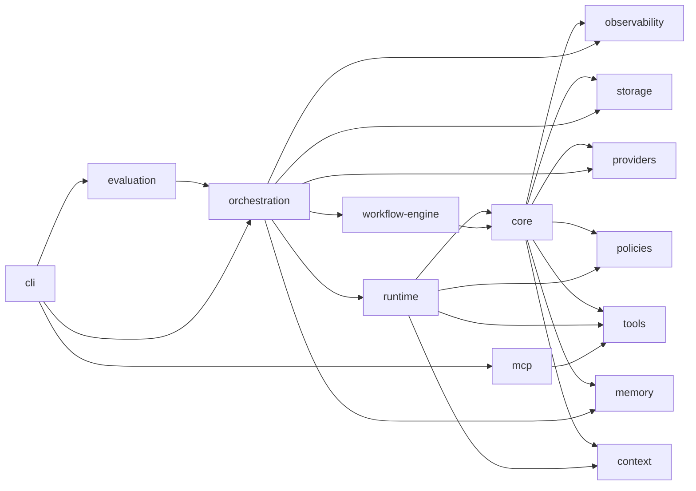
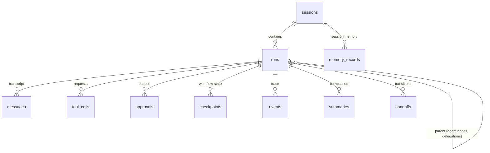

# Architecture

LoopSmith is a pnpm monorepo of small packages with one-directional dependencies. Every package depends on the contracts in `@loopsmith/core`; no package reaches into another's internals.

| Package | Responsibility | Key types |
|---|---|---|
| `core` | Vendor-neutral contracts: `ChatMessage`, `ModelRequest/Response`, `ModelProvider`, `StateStore`, `RuntimeEvent`, `LoopSmithError` (20 categories), `ExecutionLimits`, `AgentDefinition`, redaction, abortable async helpers | — |
| `storage` | `SqliteStateStore` (better-sqlite3, WAL, foreign keys, forward-only migrations) | `MIGRATIONS` |
| `observability` | `EventBus` (redact → persist → fan out), terminal renderer, metrics, pricing, JSONL export, pino logger | `RunMetrics` |
| `providers` | Anthropic and OpenAI-compatible adapters (official SDKs), `ScriptedProvider`, `ResilientProvider`, `FallbackProvider`, `ProviderRegistry`, tool-name wire mapping | — |
| `policies` | `PolicyEngine`, approval resolvers (`Defer`, `AutoApprove`, `AutoReject`, `Callback`) | `PolicyDecision` |
| `tools` | `ToolRegistry`, `ToolExecutor`, `WorkspaceSandbox`, built-in tools, safe calculator | `RegisteredTool` |
| `memory` | `MemoryManager` over FTS5 | `MemoryService` |
| `context` | `ContextManager`, token estimates, summarizers, untrusted-data detection | `BuiltContext` |
| `runtime` | `AgentRuntime` (the loop), `AgentRegistry`, meta-tools for handoff/delegation | `AgentRunResult` |
| `workflow-engine` | `WorkflowEngine`, definition schema + graph validation, templates, conditions, Mermaid | `WorkflowDefinition` |
| `orchestration` | `LoopSmith` composition root, `RuntimeWorkflowServices` bridge | `RunOutcome`, `RunInspection` |
| `evaluation` | Benchmark runner, metrics, Markdown/JSON reports, core suite | `EvalTask` |
| `mcp` | `McpToolSource`: stdio client → `RegisteredTool`s | `McpServerConfig` |

## Design decisions

**The loop is owned, not borrowed.** The agent loop, decision engine, tool orchestration, approval pause/resume and workflow engine are implemented here. Provider SDKs are used only to speak HTTP. This keeps control flow explicit and testable with a deterministic provider.

**Persist before acting.** Every model response, tool-call request, approval, tool result and workflow transition is written to SQLite before the next step. A run is therefore a replayable record, and any process can resume it.

**Synchronous storage contract.** `StateStore` is synchronous because better-sqlite3 is synchronous and transactional: state transitions are atomic with respect to the event loop. A future networked backend would need an async variant of the interface (roadmap).

**Vendor-neutral transcript.** The runtime stores `ChatMessage`s, not vendor payloads. Adapters translate on every call. Vendor-specific state that must be replayed verbatim (Anthropic thinking blocks) travels as opaque `providerState`, keeping transcripts append-only.

**Declarative workflows.** Workflow definitions are data — conditions are objects, prompts are templates — so they can be validated, rendered, stored and diffed. Deterministic logic goes into named `code` handlers registered with the engine.

**Policy in code, never in prompts.** The model sees only the tools it may use; everything it requests is re-checked by `PolicyEngine` and validated by schemas regardless.

## Data model

A workflow run is the root of a run tree; each agent node creates a child agent run; each delegation creates a grandchild. `root_run_id` lets every query (events, approvals, metrics) address the whole tree.
